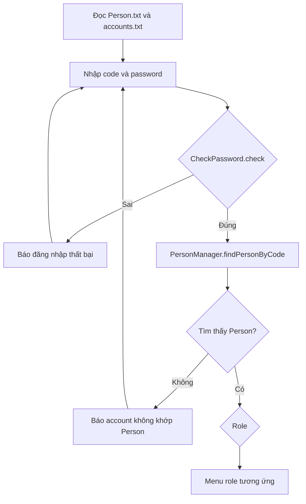

# Hướng dẫn chỉnh luồng đăng nhập trong `LoginMenu`

Tài liệu này hướng dẫn bạn tự chỉnh code. Không có file Java nào được sửa trong lần này.

## Mục tiêu

`LoginMenu` sẽ tự điều phối ba bước đăng nhập sau khi đọc dữ liệu:

1. `CheckPassword.check(code, password)` xác minh code và password.
2. Nếu đúng, `PersonManager.findPersonByCode(code)` tìm Person tương ứng.
3. Nếu tìm thấy Person, lấy `currentUser.getRole()` để mở menu theo role.

Trong code hiện có, `CheckPassword` đã có `check(String, String)` và `PersonManager` đã có `findPersonByCode(String)`. Vì vậy có thể bỏ lời gọi tới lớp `Login` đã xóa.

## 1. Dọn các field và constructor không dùng

Trong `LoginMenu.java`, kiểm tra các thành phần sau:

- Bỏ import `AttendanceManager` nếu `LoginMenu` không trực tiếp sử dụng attendance.
- Bỏ field `am` và mọi dòng khởi tạo `AttendanceManager`.
- Bỏ constructor nhận `PersonManager` và `AttendanceManager` nếu không còn nơi nào cần truyền các manager này.
- Giữ `pm`, `checker` và cơ chế nạp dữ liệu Person. Có thể khởi tạo `pm` trực tiếp bằng `PersonManager.getInstance()`.
- Giữ một constructor mặc định nếu nơi gọi `LoginMenu` đang dùng `new LoginMenu()`.

Trước khi xóa constructor có tham số, tìm toàn dự án các chỗ gọi `new LoginMenu(...)` để chắc chắn không còn phụ thuộc vào nó.

## 2. Nạp dữ liệu trước vòng lặp nhập

Giữ việc nạp `Person.txt` và `accounts.txt` trước vòng lặp đăng nhập. Nếu không đọc được một trong hai file, báo lỗi và dừng màn hình đăng nhập tại đó.

`CheckPassword.loadFromFile()` xóa các account đã nạp trong chính object `checker` trước khi đọc lại file. `PersonManager.loadFromFile()` cần được xem riêng: xác minh rằng nó thay thế danh sách Person hay nối thêm vào danh sách đang có. Nếu nối thêm, chỉ gọi nó một lần trong suốt phiên chạy hoặc điều chỉnh cách khởi tạo/nạp để tránh Person trùng.

## 3. Thay lời gọi `Login` bằng xác thực và tra Person

Xóa khỏi luồng hiện tại dòng tạo `Login` và dòng gọi `login.login(code, password)`. Thay bằng logic theo thứ tự dưới đây; đây là khung tham khảo để bạn tự nhập vào vị trí tương ứng trong vòng lặp:

```java
if (!checker.check(code, password)) {
    System.out.println(Draft.center(Draft.RED + "Login fail!" + Draft.BAS));
    Draft.pause();
    Draft.clearConsoleIDE();
    continue;
}

Person currentUser = pm.findPersonByCode(code);
if (currentUser == null) {
    System.out.println(Draft.center(
        Draft.RED + "[!] Account is valid, but no matching Person was found." + Draft.BAS
    ));
    Draft.pause();
    Draft.clearConsoleIDE();
    continue;
}
```

Sau đoạn này, `currentUser` là Person tìm được và có thể dùng cho phần chào mừng, kiểm tra role và điều hướng menu.

### Kết quả của từng nhánh

| Điều kiện | Hành động |
|---|---|
| `checker.check(...)` trả `false` | Báo đăng nhập thất bại, quay lại nhập code/password |
| Xác thực đúng nhưng tìm Person trả `null` | Báo dữ liệu account và Person không khớp, quay lại đăng nhập |
| Xác thực đúng và tìm được Person | Chào người dùng, sau đó điều hướng theo role |

Hiện `check()` chỉ trả đúng/sai cho cả cặp thông tin; nó không phân biệt code sai với password sai. Có thể dùng chung thông báo đăng nhập thất bại.

## 4. Kiểm tra role trước khi điều hướng

Sau khi có `currentUser`, kiểm tra `currentUser.getRole()` khác `null` và không rỗng trước khi gọi `trim()` hoặc `toUpperCase()`. Sau đó dùng `switch` theo role đã chuẩn hóa.

Ánh xạ role hiện tại trong `LoginMenu`:

| Role | Menu |
|---|---|
| `SITE_MANAGER` | `UserSiteManagerMenu` |
| `SAFETY_OFFICER` | `UserSafetyOfficerMenu` |
| `WORKER` | `UserWorkerMenu` |
| `CONTRACTOR` | `UserContractorMenu` |
| `VISITOR` | `UserVisitorMenu` |

Trong `WORKER`, gọi `UserWorkerMenu`, không gọi `UserSiteManagerMenu`.

## 5. Đồng bộ chữ ký giữa LoginMenu và các menu role

Đoạn gọi một tham số như:

```java
new UserWorkerMenu().displayMenuLv(currentUser);
```

chỉ biên dịch khi phương thức mà lớp menu kế thừa cung cấp cũng nhận đúng một tham số `Person`.

Trong dự án hiện tại, `MenuUserLv00` khai báo `displayMenuLv(Person currentUser, PersonManager pm, AttendanceManager am)`. Do đó, đổi lời gọi ở `LoginMenu` thôi sẽ gây lỗi biên dịch. Khi bạn muốn bỏ truyền `pm` và `am`, cần tự đồng bộ thiết kế ở `MenuUserLv00` và mọi chỗ gọi `displayMenuLv`:

1. Xác định menu cha cần giữ `currentUser` để hiện thông tin người dùng.
2. Bỏ `pm` và `am` khỏi chữ ký nếu menu cha không cần giữ/truyền chúng.
3. Cập nhật các menu con hoặc các lời gọi đang truyền ba tham số.
4. Ở từng lựa chọn chức năng, gọi manager liên quan tại nhánh chức năng đó theo API thực tế của manager.

Trước khi bỏ `AttendanceManager` khỏi menu, xem menu cha và các menu con có dùng biến `am` hay không. Nếu có, cần chuyển nơi khởi tạo/gọi manager ở các chức năng attendance tương ứng; không chỉ xóa import hoặc tham số.

## 6. Trạng thái Person có hoạt động hay không

Ba bước bạn yêu cầu chỉ xác minh account/password và tìm Person. Chúng không tự chặn Person có trạng thái không hoạt động. Trước đây tài liệu dự án mô tả `Login.login()` còn kiểm tra `Person.isActive()`. Nếu quy tắc đó vẫn cần thiết, hãy thêm một nhánh kiểm tra `currentUser.isActive()` sau khi tìm được Person và trước khi mở menu. Nếu hiện tại chưa áp dụng quy tắc trạng thái, ghi nhận đây là lựa chọn nghiệp vụ của nhóm.

## 7. Checklist sau khi tự chỉnh

- [ ] Không còn tham chiếu `Login` đã xóa.
- [ ] `checker.check(code, password)` chạy trước khi tra Person.
- [ ] Chỉ tra Person khi account/password đúng.
- [ ] Account hợp lệ nhưng không có Person tương ứng được xử lý rõ ràng.
- [ ] Role `null` hoặc rỗng không làm chương trình lỗi khi gọi `trim()`.
- [ ] Role `WORKER` mở đúng `UserWorkerMenu`.
- [ ] Chữ ký `displayMenuLv` thống nhất giữa lớp cha, menu con và mọi lời gọi.
- [ ] Xác minh chính sách `ACTIVE` và hành vi nạp lại `Person.txt`.
- [ ] Sau khi bạn chỉnh xong, biên dịch/chạy thử đăng nhập thành công, sai password, code không có trong file account, account không có Person, và role không hợp lệ.

## Sơ đồ luồng


